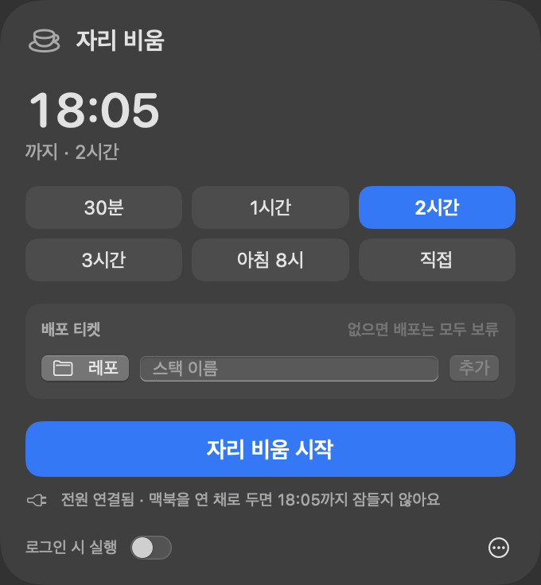
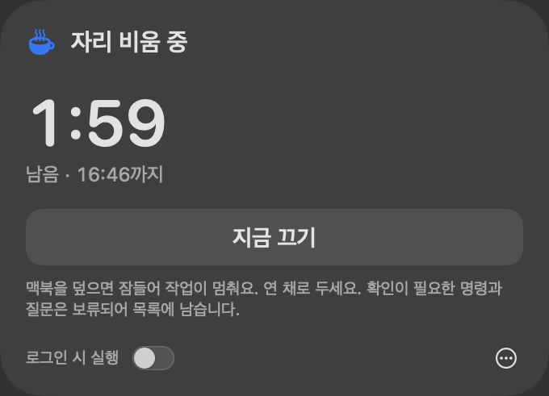

# 37writes-claude-kit

1인 개발자 37writes의 Claude Code 플러그인. 맥, 윈도우, 리눅스 어디서든 같은 개발 프로세스를 쓰기 위한 스킬과 훅 모음.

## 설치

### 다른 컴퓨터 (GitHub에서 설치)
Claude Code 안에서:
```
/plugin marketplace add 37writes/37writes-claude-kit
/plugin install kit@37writes
```
업데이트: `/plugin marketplace update 37writes` 후 `/plugin update kit@37writes`

### 이 폴더를 직접 고치면서 쓰기 (개발 모드)
```
claude --plugin-dir ~/Documents/dev/37writes-claude-kit
```
스킬을 수정한 뒤에는 Claude Code를 다시 시작하면 반영된다.

필요 조건: git, Python 3 (윈도우는 Git Bash가 함께 설치된 Git for Windows)

## 쓰는 법: 말로 요청한다

명령을 외우지 않아도 된다. 하고 싶은 일을 그대로 말하면 kit:harness가 의도를 읽고 필요한 절차(기획, 구현, 검증, 기록, 배포)를 고른다.

| 이렇게 말하면 | 일어나는 일 |
|---|---|
| "Python GIL이 뭐야?" | 답만 한다. 파일·기획서·커밋을 만들지 않는다 |
| "로그인 기능 만들어줘" | 등급(T0~T2) 분류 → 기획서(`docs/plans/`) → 구현(필요하면 Orca 워커) → 독립 검증 → 커밋. 기획서에 결과가 남는다 |
| "이 오류 고쳐줘" + 로그 | 읽기 전용 진단 먼저 → 원인이 분명하면 바로 고치고, 아니면 조사부터 |
| "이어서 해줘", "어디까지 했지?" | 모든 worktree의 진행 중 기획서만 모아 첫 미완료 단계부터 이어 한다 (어디까지면 보고만). 끝난·지운 기획서는 보고하지 않는다 |
| "이 프로젝트 구조랑 개발 순서 잡아줘" | 프로젝트 설계 `docs/plans/project.md` (모듈 경계, 기능 목록과 순서) |
| "이 화면 AI 티 안 나게 고쳐줘" | 디자인 프로필 재사용 → 공통 부품·테마 적용 → ego lite 모바일/데스크톱 조작·전후 검증 |
| "점검해줘" | 빌드·테스트 + 리뷰 결과를 먼저 보고, 고르는 것만 수정 |
| "배포해줘" | 프로필의 배포 방식대로 release 절차. 승인 조건은 harness 공통 규칙 "push와 배포", 완료는 배포한 SHA의 결과로 판정 |
| "이거 블로그로 쓰자" | 브리프(주장별 근거 포함) → 블로그 코디네이터가 글 워커 지휘·검수. 발행 승인 조건은 harness 공통 규칙 "push와 배포" |
| (다른 프로젝트에서) "kit의 이 부분 고치고 싶다" | kit 저장소에 이슈만 남기고 하던 일로 돌아간다 |

슬래시 명령(`/kit:plan` 등)으로 직접 불러도 같다.

## 스킬

| 스킬 | 하는 일 |
|---|---|
| `kit:harness` | 작업 요청의 입구. 의도 → 흐름 표, 공통 규칙(등급·배치·다른 모델 반박·승인·push·자동 배포·검증·완료 판정·기록), 이어서 하기 |
| `kit:plan` | 코드를 먼저 읽고 추천값이 달린 질문으로 기획서 또는 프로젝트 설계(`docs/plans/project.md`) 작성 |
| `kit:init` | 프로필(CLAUDE.md)에 작업에 필요한 사실만 보완, commit-msg 훅. 기존 내용은 덮지 않는다 (AGENTS.md만 있으면 `@AGENTS.md` + 프로필). 값은 `미정`(확인 전, 다시 채움)과 `없음 (확인함)`을 나누고, 여러 폴더면 `폴더: 명령 · 폴더: 명령` |
| `kit:commit` | 변경을 논리 단위로 나눠 `type(scope): 한국어 요약` 형식으로 커밋 |
| `kit:check` | 프로필의 빌드·테스트 + 언어별 체크리스트 리뷰, 보고 후 승인된 것만 수정 |
| `kit:design` | 개인 디자인 시스템: 규칙·부품 재사용, 버전 있는 테마 CSS, 프로젝트 프로필, 한 디자이너 점검, 레퍼런스 보드와 시안 비교로 방향 선택, 대화형 화면 패턴(동작 계약 + 배치 예시), 정돈 규칙(같은 역할 기준선·판단에 필요한 정보만)과 정돈 점검, UI 선택은 예시 화면 비교로, 레퍼런스 해부(원칙·구조·인터랙션·질감·문구·시스템을 실측/문서/추론으로 뜯어 토큰으로 옮김), ego lite 기기·상황별 터치·반응형 검증 |
| `kit:release` | 버전·릴리즈 노트·CHANGELOG, 배포(자동 배포 정책이면 `deploy_gate.py`로 검증·확인), Amplify는 그 SHA의 job + 핵심 기능 확인 / exe 묶음·체크섬 / 앱(첫 배포 때 확정) |
| `kit:blog` | 대화·기획서·커밋으로 블로그 글(시리즈 가능). tech-blog의 "블로그 코디네이터" 탭이 글마다 worktree와 글 워커를 띄워 지휘(도표 SVG, 다른 모델 검수, 회사 정보 필터링), 승인받은 글만 발행 |
| `kit:feedback` | 다른 프로젝트에서 떠오른 kit 개선 아이디어를 이 저장소에 GitHub 이슈(feedback 라벨)로 |

## 기록: 기획서와 커밋

따로 쓰는 작업 로그는 없다. 기록은 작업 중 필요한 만큼만 남긴다.

- 질문은 아무 파일도 만들지 않는다. 작은 수정은 커밋 메시지가 기록이다.
- 기능 작업은 기획서(`docs/plans/YYYY-MM-DD-<slug>.md`)의 결정 & 이유, 단계별 결과, `## 남은 일`에 적는다. 단계 결과는 그 단계의 커밋에 같이 들어가고, 기획 커밋부터 그 작업의 모든 커밋 본문에 `Refs: docs/plans/<파일>`이 붙는다.
- **끝난 기획서는 지운다.** 마지막 작업 커밋에 `status: done`(그만두면 `abandoned` + 이유)과 마지막 결과·`## 남은 일`을 넣고, 바로 뒤 삭제 커밋(`docs(plan): <slug> 완료, 기획서 삭제`)에서 기획서와 보고서 폴더를 `git rm`한다. 남은 파일이 곧 진행 중인 작업이라 나중에 헷갈리지 않는다. `docs/plans/project.md`는 남기고 끝난 항목에 `완료 <커밋>`을 적는다.
- 지운 기획서 찾기:
  ```sh
  git log --all --format='%h %s' -- docs/plans/<파일>     # 그 기획서를 건드린 커밋 (맨 위가 삭제 커밋)
  git show <삭제 커밋>^:docs/plans/<파일>                  # 지우기 직전 내용 (done 상태와 결과)
  git log --grep "Refs: docs/plans/<파일>"                # 그 작업의 커밋
  ```

## 자동 배포 (선택)

push가 곧 배포인 레포에서 프로필에 정책 줄을 두면, 정책 안의 배포를 검증 기록과 함께 끝까지 진행할 수 있다. 어떤 배포가 정책 안이고 언제 승인을 받는지(승인 조건)는 harness 공통 규칙 "push와 배포"에 있다.
```
- **자동 배포**: 허용 · 대상 `origin/main` · 검증 `npm ci && npm test` · 제외 `infra/**`, `amplify/backend/**` · 확인 `sh scripts/check_deploy.sh {sha}`
```
- `대상`·`검증`·`확인`은 필수, `제외`는 선택. 하나라도 없거나 형식이 틀리면 정책 없음.
- 순서: `deploy_gate.py verify`(그 SHA의 깨끗한 임시 checkout에서 검증 명령 실행·기록, 검증 명령이 추적 파일을 바꾸면 실패) → `git push <원격> <40자리 SHA>:refs/heads/<브랜치>` → `deploy_gate.py confirm`(확인 명령에 SHA를 넣어 실행, exit 0일 때만 완료).
- guard(위험 명령 확인 훅)가 push 때 대조하는 것: 전체 SHA push 하나, 원격·브랜치가 정책 대상과 같음, push URL = fetch URL, 실제 원격 base에서 fast-forward, base와 SHA의 정책이 같음, 그 SHA의 검증 기록(tree·정책·명령 일치, exit 0), 바뀐 파일이 `제외` 밖이고 시크릿 패턴 없음. 하나라도 어긋나면 확인 창이 뜬다.
- guard가 판단하지 못하는 것(IAM·시크릿·인프라·마이그레이션·데이터 삭제, 태그 push 등)의 승인도 harness 공통 규칙 "push와 배포"에 있다.
- 배포 실패(`confirm` 실패·시간 초과)면 멈추고 SHA·실행 id·롤백 방법을 보고한다. 자동 롤백은 없다.
- **한계**: guard는 Claude의 Bash 명령을 보는 best-effort 확인이지 권한 경계가 아니다. 검증 기록 폴더를 건드리는 명령은 묻지만, 다른 경로로 기록 파일을 고치는 것까지 막지는 못한다. 확인 명령이 HTTP 200만 보면 완료 증거가 되지 않으므로 그 SHA의 배포 실행과 핵심 기능을 확인하게 쓴다.
- 블로그(tech-blog)는 이 정책을 쓰지 않는다 (발행 절차는 blog 스킬).

## 자리 비움 모드

회의나 잠으로 자리를 비운 동안 에이전트가 확인 창·질문에서 몇 시간씩 멈추지 않게 한다. 상단바 앱에서 끝 시각을 고르고 떠나면 그 시각까지:

- 평소 확인 창이 뜰 명령은 창 대신 **거절**되고 아침 목록에 쌓인다. 에이전트는 다른 일을 계속한다.
- 질문 창은 뜨지 않고 보류 목록에 남는다. 글로 묻고 멈춘 탭은 최대 2번 "기본값으로 정하거나 보류하고 계속하라"로 이어진다.
- **배포 티켓**을 준 CDK 스택만, 테스트와 `cdk diff` 검사를 통과하면 배포된다 (아래). 티켓이 없으면 통과되는 명령은 하나도 늘지 않는다.
- 질문 창에 추천 표시(`(Recommended)`·`(추천)`)가 붙은 선택지가 하나면 거절 안내에 그 이름이 들어간다 (여러 개 고르는 질문은 제외). 되돌릴 수 있는 결정은 에이전트가 그것으로 정하고, 배포·삭제·권한·push 승인은 추천이 있어도 보류한다.

**잠자기만 막기** (0.24.0): 자리에 있으면서 맥이 잠들어 에이전트가 멈추는 것만 막고 싶을 때. 잠자기 방지(`caffeinate`)만 켜고 확인 창·질문 창은 평소대로 뜬다 (새 거절·보류·배포 티켓 없음. 나머지는 꺼져 있을 때와 같아서, 전에 쌓인 아침 목록이 있으면 세션 시작 때 건수 알림은 나온다). 배터리에서도 켜진다 (키 입력이 없을 때의 잠자기만 막는다). 떠날 때는 자리 비움으로 다시 켠다.

**kit 업데이트 전에 시작한 Claude 탭** (0.24.0): 훅 목록은 Claude 프로세스가 뜰 때 고정된다. 업데이트 전에 뜬 탭은 자리 비움을 켜도 질문 보류·이어 가기가 없을 수 있어 밤새 질문에서 멈춘다. 그런 탭이 Bash를 부르면 기록해 두었다가 자리 비움을 켤 때와 앱에 "재시작 권장"으로 보여 주고, 그 탭 안에서는 "질문 창을 쓰지 말고 글로 묻고 끝내지 말라"는 안내를 넣는다. 탭을 다시 시작하면 사라진다.

### 상단바 앱 (macOS 14 이상)

```sh
sh <kit>/macos/install.sh        # 빌드해서 ~/Applications/AwayBar.app 에 설치 (Xcode 명령줄 도구 필요)
open ~/Applications/AwayBar.app
```

 

모드(`자리 비움` | `잠자기만 막기`. 열 때마다 `자리 비움`이 기본이고 마지막 선택을 기억하지 않는다), 끝 시각(30분·1·2·3시간·아침 8시·직접), 배포 티켓(자리 비움만. 에이전트가 남긴 후보나 직접 추가)을 고르고 시작 단추. 재시작이 필요한 탭이 있으면 주의 카드가 보인다. 켜져 있는 동안 상단바에 남은 시간이 보인다. 돌아와서는 탭별 마지막 활동, 실행된 배포, 거절된 명령, 보류된 질문을 본다. 앱은 `away.py --json`만 부르므로 앱을 꺼도 모드는 그대로다. kit 폴더는 `~/.claude/plugins` 설치 기록 → `~/Documents/dev/37writes-claude-kit` 순으로 찾고, 못 찾으면 패널 아래 "kit 폴더"로 고른다. 이 Mac에서 빌드해 쓰는 앱이다 (공증 없음). kit를 업데이트하면 **바로** `install.sh`를 다시 돌린다. 0.23 앱은 잠자기만 막기를 모른다: 새 kit를 읽으면 잠자기 방지 중인데도 "자리 비움 중 · 확인이 필요한 명령은 보류"로 잘못 보이고(끄기는 된다), 앱 안의 예전 사본을 읽으면 "꺼짐"으로 보이고 끄지 못한다.

### 배포 티켓

```sh
away.py on --for 8h --ticket '<레포 경로>::<스택>[::횟수]'    # 앱의 체크박스와 같다. 횟수 기본 1, 최대 3
away.py request --stack <스택> --note "<왜>"                  # 에이전트가 떠나기 전에 남기는 후보 (권한 아님)
away_deploy.py run --stack <스택> --cwd <cdk 앱 폴더>         # 에이전트가 부르는 실행기
```

실행기는 ① 유효한 모드와 같은 레포·스택의 남은 티켓 ② 티켓을 만들 때 프로필 `테스트` 줄에서 고정한 명령 통과 ③ `cdk diff <스택> --exclusively`에 리소스 삭제·교체·IAM·보안 그룹 변경이나 해석하지 못한 줄이 없음을 확인한 뒤 `cdk deploy <스택> --exclusively --require-approval never`를 한 번 실행한다. 하나라도 어긋나면 배포하지 않고, 배포가 실패하면 티켓을 잠근다 (재시도·롤백 없음). 티켓은 끝 시각이 지나거나 끄면 사라진다. CDK가 아닌 배포(terraform, amplify, 배포가 되는 push)는 티켓이 없다.

**티켓 범위 안에서는 사람이 보지 않은 코드가 배포된다.** 테스트와 diff 검사를 통과한 런타임 버그는 막지 못한다. 새 IAM 역할이 생기는 변경(람다 추가 등)은 IAM 변경이라 배포되지 않는다.

### 명령

```sh
! sh <kit>/scripts/py.sh <kit>/scripts/away.py on --until 08:00   # 또는 --for 3h. 최대 12시간
! sh <kit>/scripts/py.sh <kit>/scripts/away.py on --for 2h --mode awake   # 잠자기만 막기 (확인 창·질문은 평소대로)
! sh <kit>/scripts/py.sh <kit>/scripts/away.py off                # 어느 모드든 끄고 아침 목록을 보여 준다
! sh <kit>/scripts/py.sh <kit>/scripts/away.py report             # 거절된 명령·보류된 질문·실행된 배포 (--clear로 비움)
```

- 끝나는 시각은 필수이고, 그 시각이 지나면 스스로 꺼진 것으로 본다 (다시 평소 확인 창). 넉넉히 잡는다. 상태는 `~/.config/37writes-kit/away/` 하나라 같은 계정의 모든 레포·세션에 걸린다.
- macOS에서는 전원과 뚜껑을 확인하고 `caffeinate -i -s`로 유휴 잠자기를 막는다. 배터리·전원 미확인·뚜껑 닫힘이면 켜지 않는다 (뚜껑 정보가 없는 데스크톱은 켠다). **켠 뒤 뚜껑을 닫으면 잠들고, 전원을 뽑으면 키 입력이 없을 때의 잠자기만 막는다** (`-s`는 전원 연결 때만 듣고 `-i`는 남는다. 실제 기기에서 전원을 뽑아 확인하지는 않았다). 다른 OS는 절전 방지를 건너뛴다. `--mode awake`는 배터리에서도 켜고 주의만 준다 (뚜껑 닫힘·전원 미확인은 똑같이 거부).
- 모드는 한 번에 하나다. 다시 `on`하면 이전 모드와 잠자기 방지를 바꾼다 (자리 비움 → 잠자기만 막기로 바꾸면 티켓도 사라진다). 잠자기 방지 상태는 `awake.json`에 따로 두어, 다른 버전의 kit로 떠 있는 탭도 "꺼짐"으로 읽는다.
- 아침 목록에는 레포, 이유, 명령(`이름=값`의 값과 시크릿 패턴을 가리고(완전하지 않다. 0600 파일이고 대화에는 건수만 붙는다) 긴 명령은 앞 150자 + 뒤 60자)이 남고, 같은 명령은 한 건으로 묶여 횟수가 보인다. 자동으로 다시 실행하지 않는다.
- 돌아와서 일할 때 켜져 있으면 확인 창 대신 거절이 온다. 거절 이유에 끝 시각이 보이고 `off`로 끈다. 사용자의 `! 명령`은 훅을 거치지 않으므로 모드와 상관없이 실행된다.

| 명령 | 끝 코드 | `--json` 출력 |
|---|---|---|
| `on --until HH:MM` \| `--for 3h` `[--mode away\|awake]` `[--ticket …]` | 0 켬 · 2 인자 오류(`no_until` `bad_time` `too_long` `bad_ticket`(awake에 티켓 포함) `usage`(모르는 모드 포함)) · 3 시작 거부(`on_battery`(away만) `lid_closed` `power_unknown`) · 4 `caffeinate_failed` · 1 그 밖(`state_not_saved`: 상태를 못 써서 켜지 않음, 이전 모드는 그대로) | status와 같은 모양 + `warnings`. 실패는 `{ok:false, error, message}` |
| `off` | 0 (꺼져 있어도) · 1 `state_not_removed`(상태 파일이 남음. 절전 방지는 이미 풀렸을 수 있으니 `status`로 확인) | `{ok, was_active, mode, caffeinate_released, queue_count}`. 실패는 `{ok:false, error, message}` |
| `status` | 0 | `{ok, active(어느 모드든 켜짐), mode(away\|awake\|null), stale_sessions:[{session, repo, cwd, seen_at, basis(pid\|time)}], expired, until, until_epoch, remaining_seconds, started, caffeinate:{pid, alive}, power:{source, lid}, queue_count, checks, holds_count, tickets:[{id, repo, stack, limit, used, locked, note, tests}], ticket_candidates:[{repo, stack, source, note}], sessions:[{session, repo, cwd, last_event, last_event_at, last_activity_at}]}`. 꺼져 있으면 시각은 `null`, 만료면 `expired:true` |
| `report [--clear]` | 0 | `{ok, count, items:[{key, first, last, count, repo, reasons, command}], holds:[{ts, kind, repo, session, text}], runs:[{ts, repo, stack, result, code, steps, diff, log}]}` |
| `request --stack <스택>` | 0 · 2 인자 오류 | `{ok, repo, stack}` |
| `away_deploy.py run --stack <스택>` | 0 배포됨·변경 없음 · 2 인자 오류 · 3 티켓 없음·소진·잠김 · 4 검사에서 막힘 · 5 배포 실패 · 1 그 밖 | `{ok, result(deployed\|no_changes\|blocked\|failed\|refused), stack, message, steps, diff, log}` |

`--json`이면 오류까지 stdout에 JSON 하나만 나온다 (메뉴 막대 앱이 부르는 계약, `scripts/test_away.sh`·`test_away_deploy.sh`가 고정).

**한계**
- 별도 인증이 없다. 훅과 에이전트가 같은 계정(UID)으로 돌아서 **모드를 켜거나 티켓을 만든 것이 사람인지 증명하지 못한다**. 에이전트가 `--ticket`으로 켜는 명령은 guard가 확인 대상으로 보지만(자리 비움 중이면 거절) best-effort다.
- guard는 Claude의 Bash 명령을 보는 best-effort 확인이다. 스크립트 파일로 감싼 명령은 보지 못하고, 훅이 죽거나 시간을 넘기면 명령이 실행된다. 거절 뒤 다시 시도하지 않는 것은 거절 이유와 harness 규칙에 기대며, 목록의 횟수로 반복을 볼 수 있다.
- 글로 묻고 멈춘 것은 글자로 알아본다 (끝부분의 물음표, "할까요", "Should I" 등). 물음표 없는 대기는 놓치고, 완료 보고의 물음표로 한 턴이 더 돌 수 있다 (세션당 2번까지, 두 번째는 도구 호출 3건 이상의 진전이 있을 때만). Orca 워커와 서브에이전트는 이어 가게 하지 않는다.
- `cdk diff` 해석은 실제 CDK 버전의 출력으로 보정하지 않았다. 모르는 줄이 있으면 배포하지 않는 쪽이라, 첫 사용에서 정상 변경이 막힐 수 있다 (그때 로그를 보고 고친다).
- 배포 실행기 로그(`~/.config/37writes-kit/away/logs/`, 0600)에는 테스트·cdk가 출력한 글이 그대로 남는다 (`이름=값` 모양만 가린다). 실패 원인을 보려고 남기며 `report --clear`(패널의 비우기)가 지운다.
- 사용량 한도, 로그인 만료, 네트워크 끊김으로 멈춘 세션은 다시 살리지 않는다.
- kit 훅은 Claude Code에서만 돈다. Codex·opencode 같은 다른 에이전트 탭의 자체 권한 창은 막지도 넘기지도 못한다. 지휘 세션이 그 알림을 받으면 기다리지 않고 거절·보류하게 하는 규칙(harness)뿐이다.
- "재시작 권장"은 **보인 탭만** 알려 준다. 업데이트 뒤 Bash를 한 번도 안 부른 예전 탭, kit 없이 뜬 Claude, 다른 에이전트 탭은 보이지 않는다 (목록이 비어도 예전 탭이 없다는 뜻이 아니다). `--plugin-dir`로 한 폴더를 계속 읽는 설치에서만 동작하고, 플러그인 캐시 설치(버전별 폴더)의 예전 탭은 예전 스크립트를 그대로 써서 기록되지 않는다. 0.23에서 뜬 탭(자리 비움 훅은 다 있음)도 업데이트 직후 한 번 권장으로 나온다. 프로세스 번호를 못 읽으면 마지막 관측 뒤 2시간 동안만 추정으로 보인다.

## /kit 패널

`/kit`을 입력하면 kit 패널이 열리고, 한 번 더 입력하면 닫힙니다. Claude를 거치지 않으므로 토큰을 쓰지 않습니다.

- **스킬**: 설치된 `/kit:*` 명령과 한 줄 설명 (스킬을 추가하면 자동 반영)
- **이 프로젝트**: 구분, 진행 중 기획서(제목·상태·남은 단계). Claude의 답이 끝날 때마다 갱신

패널을 띄울 수 없는 환경(`claude -p` 등)에서는 같은 내용을 텍스트로 보여 줍니다.

## 훅 (자동 실행)

| 훅 | 시점 | 하는 일 |
|---|---|---|
| 이어하기 | 세션 시작 (kit 프로젝트만) | "작업 요청은 kit:harness를 먼저 읽는다" 한 줄과 모든 worktree의 진행 중 기획서 목록을 Claude에게 전달, commit-msg 훅이 없으면 설치. 프로필 테스트 줄이 `미정`·맨 "없음"인데 레포에 테스트 설정(package.json scripts의 test, pyproject 등)이 있으면 재확인 알림 한 줄. kit 레포에서는 열린 feedback 이슈 표시 |
| Orca 작업 절차 | 세션 시작 (Orca IDE 안에서만, 모든 레포) | 워커/지휘 세션 판정, 지휘 세션은 첫 요청 전에 kit:harness를 읽고, 다른 모델 의견은 Orca 워커 탭으로 |
| 위험 명령 확인 | 명령 실행 직전 (모든 레포) | git push(프로필이 `push: 배포 아님`이면 강제·삭제 push만, 자동 배포 정책 안의 SHA push는 통과), reset --hard, rm -rf ~, DROP TABLE, AWS 삭제, cdk deploy, terraform apply, IAM 권한 변경 등은 사용자 확인 |
| 자리 비움 질문 보류 | 질문 창 직전·턴 종료 (모든 레포, 모드가 켜져 있을 때) | 질문 창은 거절하고 보류 목록에, 글로 묻고 끝낸 턴은 최대 2번 이어 가게 한다 (Orca 워커·서브에이전트 제외). 꺼져 있으면 아무것도 하지 않는다 |
| 자리 비움 알림 | 세션 시작·요청마다 (모든 레포, 모드가 켜져 있을 때) | "HH:MM까지 자리 비움 모드" 한 줄: 확인이 필요한 일은 아침 목록으로, 되돌릴 수 있는 결정은 기본값으로, 다른 일을 계속. 꺼져 있고 아침 목록이 남았으면 세션 시작 때 건수만. 잠자기만 막기(`--mode awake`)는 꺼져 있을 때와 같다 (모드 알림·거절·보류 없음). kit 업데이트 전에 시작한 탭은 위험 명령 확인 훅이 Bash 호출 때 같은 알림 + 재시작 안내를 넣는다 (켠 회차마다 1번, 30분이 지나면 다시) |
| commit-msg (git 훅) | 모든 커밋 | 커밋 메시지 형식 검사. VS Code에서 직접 커밋해도 적용 |

kit 프로젝트 = CLAUDE.md에 프로필 블록(`<!-- 37writes-kit:profile:start -->`)이 있는 git 레포. 예전에 init한 레포(`docs/devlog/`가 있음)도 호환으로 인식한다. `docs/plans/`만 있는 레포는 kit 프로젝트가 아니다. kit 프로젝트가 아니어도 "이어서 해줘"는 동작한다.

## 없앤 기능 (0.15.0)

| 없앤 것 | 이유 | 과거 파일 |
|---|---|---|
| `/kit:devlog` 작업 로그, 답변 끝 devlog 알림(Stop 훅) | 결정·결과는 이미 기획서에 있고 커밋은 `Refs`로 찾는다. 같은 내용을 두 번 적고 알림이 흐름을 끊었다 | 각 레포의 `docs/devlog/`는 그대로 둔다 |
| `/kit:til` 개념 메모 | 배운 것은 기획서의 결정 & 이유에 남는다. 블로그 원료는 대화·기획서·커밋으로 충분하다 | my-notes 저장소는 삭제 (2026-10-30, 사용자 결정). 블로그는 사용자가 지정한 메모 파일만 읽는다 |
| `/kit:weekly` 주간 정리, kit 등록부 쓰기 | 등록부를 읽던 곳이 weekly뿐이었다 | 등록부 `~/.config/37writes-kit/repos.txt`와 my-notes는 삭제 (2026-10-30, 사용자 결정) |

## 커밋 형식
```
feat(auth): 소셜 로그인 추가

- 구글/애플 OAuth 연동
Refs: docs/plans/2026-10-14-social-login.md
```
type: feat, fix, docs, refactor, perf, test, style, build, ci, chore, revert

## 로드맵
- [x] init, commit, devlog(0.15.0에서 제거), 훅
- [x] plan, til(0.15.0에서 제거)
- [x] blog (GitHub Pages, 글마다 핵심 개념 도표)
- [ ] docs (회사/대학원 양식), 애드센스 연결 (개인 도메인 구매 후)
- [x] check, release, weekly(0.15.0에서 제거)
- [x] harness (AWS Deep Insight식 에이전트 작업 절차), 대화 기반 블로그 시리즈
- [x] Orca IDE에서 시작한 세션에 harness 절차 자동 안내 (모든 레포)
- [x] design (AI 티 안 나는 화면, tech-blog 종이 노트로 시범)
- [x] blog를 글마다 worktree로 (말로 시작, 승인 뒤 main 병합), guard에 ampx·deploy.sh 확인
- [x] push가 배포가 아닌 레포는 커밋 승인만으로 push (guard가 프로필의 push 줄을 읽음)
- [x] 기획은 다른 모델이 반박, 배치는 불확실성·분리 가능성으로, 승인 규칙 정리, 검증자가 고른 실패 시나리오
- [x] blog 코디네이터 (tech-blog 본체 탭이 글 워커를 띄우고 검수·병합·정리)
- [x] 0.15.0: 말로 요청하면 harness가 절차를 고름, 기록은 기획서와 커밋(끝나면 기획서 삭제), 모든 worktree에서 이어서 하기, 프로필 자동 배포 정책, 프로젝트 설계(project.md). devlog·til·weekly 제거

- [x] 0.16.0: design을 개인 디자인 시스템으로 확장(core/neutral/paper, 출처·버전·해시, ego lite 전용 측정·터치 검증). blog 캡처도 ego 사용
- [x] 0.17.0: design에 한 디자이너 점검, 기기·상황 행(영향 행만, 적용/비해당/미검증), 레퍼런스 보드·시안 2~4개·선택표로 방향 선택. 문서 계약 v1.1.0(CSS 자산 그대로)
- [x] 0.18.0: design에 대화형 패턴(작업 화면의 하위 패턴): 동작 계약 7개, 연속 조작에서 깨지는 곳 9개, 한 프로젝트에서 검증한 배치 권장값, 답 구성, 음성 자리. 문서 계약 v1.2.0(CSS 자산 그대로)
- [x] 0.19.0: design에 정돈 규칙(의무와 3열 작업 화면 권장값 분리, 판단 과업을 지키는 정보 빼기), 정돈 점검(역할·선택자 측정, 0개 매칭은 미검증, 전후표), UI 선택은 예시 화면 비교 이미지로 묻기. 문서 계약 v1.3.0(CSS 자산 그대로)
- [x] 0.20.0: design에 레퍼런스 해부(프로필로 해결 → 부분 해부 → 전체 해부, 핵심 출처 1곳부터, 여섯 축은 고르는 목록), ego 상태 관찰 계약(누름 유지·포커스 분리·선언 대 실행 중 값·빈 결과는 미검증), 해부 시트(기준 출처·평균 금지), 토큰 → 소비 선언 → 계산값 추적(미연결 토큰은 실패). 문서 계약 v1.4.0(CSS 자산 그대로)
- [x] 0.21.0: 프로필 값 `미정`과 `없음 (확인함)` 구분, 폴더별 명령 형식(`web: … · tools: …`). init·harness·plan·check가 `미정`·맨 "없음"을 다시 채울 대상으로 보고(check는 보완 후보만 제안), SessionStart가 테스트 설정이 있는데 테스트 줄이 `미정`·맨 "없음"이면 재확인 알림(2초 안, 실패하면 건너뜀)
- [x] 0.22.0: 자리 비움 모드 1단계. `away.py on --until HH:MM`으로 켜면 확인 창 대신 거절 + 아침 목록(권한은 그대로), macOS는 전원·뚜껑 점검 뒤 `caffeinate`, 세션 시작·요청마다 모드 알림, 메뉴 막대 앱이 부를 끝 코드·JSON 계약
- [x] 0.23.0: 자리 비움 2단계. macOS 상단바 앱 AwayBar(`macos/install.sh`), guard가 글 속의 단어(커밋 메시지·heredoc·grep 인자)를 명령으로 오인하지 않게 셸 구문 해석 + `cdk --profile x deploy` 같은 미탐 보강, 질문 창 보류와 글 질문 뒤 조건부 재개(Stop 훅), CDK 배포 티켓과 실행기 `away_deploy.py`(테스트·`cdk diff` 검사 뒤 1회), 탭별 마지막 활동
- [x] 0.24.0: 잠자기만 막기 모드(`--mode awake`, 앱의 모드 선택: 확인 창·질문은 평소대로, 배터리 허용), kit 업데이트 전에 시작한 Claude 탭을 기록해 "재시작 권장"으로 보이고 그 탭에 안내, 질문 창 거절 안내에 추천 선택지, 다른 에이전트 워커의 권한 창에서 기다리지 않는 규칙
